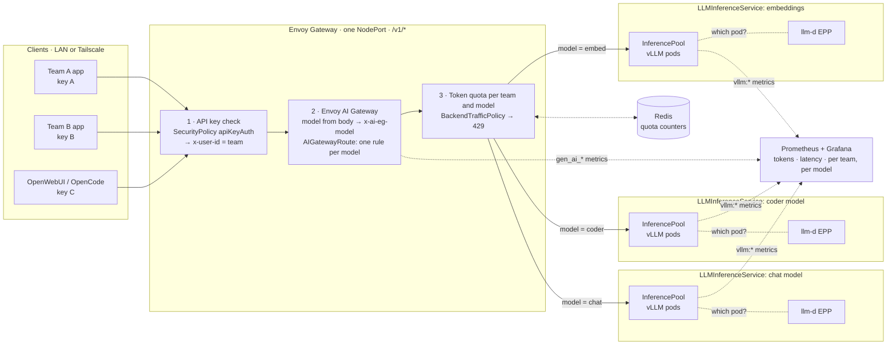

# KServe

Kubernetes' standard API for serving models (`InferenceService`), and the base for a company-style
OpenAI-compatible platform (see [Target](#target-a-company-style-openai-planned-not-installed-yet)).

It is installed in **Standard mode** (also called RawDeployment): each model becomes a normal Deployment + Service,
without Istio or Knative, so there is no scale-to-zero and no extra networking layer. Argo CD does not manage it.

## How it was installed

First installed on 2026-11-16 from `master`; since 2026-11-17 it's the **v0.21.0 release**, every image pinned to
`:v0.21.0` (no `:latest`). [`install.sh`](install.sh) makes a git worktree of the upstream repo at the tag
(`~/src/repos/kserve-v0.21.0`) and runs:

    FORCE_UPGRADE=true UPDATE_CONFIGMAP_IMAGES=true ./hack/kserve-install.sh --kustomize --standard --kserve-version v0.21.0

- `--kserve-version` swaps `:latest` for `:v0.21.0` in the manifests, and `UPDATE_CONFIGMAP_IMAGES=true` does it in
  the `inferenceservice-config` ConfigMap too (agent, storage initializer, router).
- `FORCE_UPGRADE=true` applies over an existing install. **Never use `--reinstall`**: it uninstalls first, deleting
  the CRDs and with them every `InferenceService`.
- Extra arguments go through, e.g. `./install.sh --type kserve,llmisvc`.
- Side effect: the built-in `kserve-vllmserver` runtime now points at `vllm/vllm-openai:v0.21.0`. We don't use it.

What the script installs, in order:

1. **Helm and yq**, if they're missing on the machine that runs it.
2. **cert-manager v1.17.0** (Helm release `cert-manager`, namespace `cert-manager`). KServe's webhooks need it for
   their TLS certificates.
3. **KServe** in the `kserve` namespace (the controller runs on k8s-master, see below): the CRDs (`InferenceService`,
   `ServingRuntime`, `ClusterServingRuntime`, `InferenceGraph`, `TrainedModel`), the controller, and the default
   `ClusterServingRuntimes` (16 of them: vLLM, Hugging Face, SGLang, Triton, sklearn, xgboost and others). It builds
   them with `kustomize` from `config/overlays/standalone/kserve` and sets the default deployment mode to `Standard`.

Not installed: Istio, Knative, KEDA, the Gateway API/Envoy Gateway, LocalModel or `LLMInferenceService` (those
need `--type llmisvc` / `--keda`).

## Check it

    kubectl get pods -n kserve                  # kserve-controller-manager Running
    kubectl get clusterservingruntimes
    kubectl get cm inferenceservice-config -n kserve -o jsonpath='{.data.deploy}'   # "defaultDeploymentMode": "Standard"

## Notes

- There's no ingress: reach a model through its Service (`<name>-predictor.<namespace>`) inside the cluster, or
  with `kubectl port-forward`.
- GPU models need the same settings as the rest of the cluster: `runtimeClassName: nvidia`, the `nvidia.com/gpu`
  toleration and a GPU request.
- Uninstall everything the script added (cert-manager too): `./hack/kserve-install.sh --uninstall`.

## Controllers on k8s-master

The KServe controller and cert-manager run on **k8s-master**, next to the API server (`install.sh` patches them
after the install). On endurance-1 (WiFi) they kept losing the API connection ("http2: client connection lost"),
lost their leader lease and crash-looped every ~5 minutes; while the controller is down, its webhook rejects every
`InferenceService`.

## Qwen3.8-27B on vLLM ([`models/`](models/))

The same model and flags as the plain Deployment in [`../vllm/qwen38-27b-single/deploy`](../vllm/qwen38-27b-single/deploy)
(kept at replicas 0), as an `InferenceService` on our own `ServingRuntime` (`vllm-hf-cache`). Applied by hand; Argo CD
doesn't manage it. It needs **both GPUs**, so Rocky (voice + llama.cpp brain) is at 0 while it runs (since
2026-11-17).

How it fits the runtime:

- **Runtime:** [`servingruntime.yaml`](models/servingruntime.yaml) is KServe's vLLM runtime without `--model` and
  `--served-model-name`. KServe v0.21.0 appends the `InferenceService`'s args to the runtime's without removing
  duplicates, so with the built-in runtime vLLM took its `--model=/mnt/models` and crashed. (`master` de-duplicates
  flags; v0.21.0 doesn't.)
- **Model:** no `storageUri`. vLLM loads `unsloth/Qwen3.8-27B-NVFP4` by name from heavy1's Hugging Face cache
  (hostPath `/mnt/vllm/hf`, `HF_HUB_OFFLINE=1`). A `pvc://` URI into an HF cache would break: its files are relative
  symlinks into `../../blobs`.
- **Compile cache** `/mnt/vllm/cache` is shared with the plain Deployment: the first start took ~2 minutes.
- **Chat template:** a copy of the plain Deployment's `chat_template.jinja`, in a ConfigMap without a hash suffix
  (kustomize can't rename references inside an `InferenceService`). After changing it, restart the predictor.
- KServe adds a `kserve/agent:latest` sidecar and a CPU HPA (`minReplicas = maxReplicas = 1`, so it never scales).

Measured on 2026-11-17: ~48 tok/s for a 200-token answer (llama.cpp on the same model: ~22).

    kubectl apply -k models/
    kubectl get isvc -n models                                      # READY True
    kubectl logs -n models deploy/qwen38-27b-predictor -c kserve-container -f
    kubectl port-forward -n models svc/qwen38-27b-predictor 8080:80
    curl localhost:8080/v1/chat/completions -H 'Content-Type: application/json' \
      -d '{"model":"qwen3.8-27b","messages":[{"role":"user","content":"Hi"}],"chat_template_kwargs":{"enable_thinking":false}}'
    kubectl delete -k models/                                       # frees the GPUs (e.g. to bring Rocky back)

**Disk:** the vLLM image (8.7 GB compressed) needs ~25-30 GB free while it unpacks. heavy1 evicts below ~33 GB
free; on 2026-11-16 a pull with 45 GB free evicted Rocky. Start with ~60 GB free.

---

## Target: a company-style "OpenAI" (planned, not installed yet)

The goal is to look like what a big company runs in-house: **one OpenAI-compatible endpoint, several models behind
it, an API key per team, token quotas per team, and a usage dashboard**. Clients only change `base_url` and
`api_key`; the `model` field in the request picks the model.

Status: only the KServe part above is installed. Everything in this section is the design, based on the KServe and
Envoy AI Gateway docs (see [Sources](#sources)).

### Who does what

Three projects, each doing one job. None of them is "the gateway and the router and the server" on its own:

| Layer | Project | Its job |
|---|---|---|
| **Gateway** (front door) | **Envoy Gateway + Envoy AI Gateway** | Receives every request on `/v1/...`, checks the team's API key, reads `model` from the JSON body, applies the team's token quota, counts tokens for the dashboard, and sends the request to that model's pool. |
| **Router** (which pod) | **llm-d** (Endpoint Picker, EPP) | One per model. The gateway asks it which replica should serve the request; it picks the pod most likely to have the prompt cached and least busy. It does not receive traffic itself. |
| **Serving** (the models) | **KServe `LLMInferenceService`** + **vLLM** | One resource per model. KServe creates the vLLM pods, the `InferencePool` that groups them, and the llm-d EPP for that pool. |

In the old `vllm/qwen-llmd` experiment, llm-d ran in *standalone* mode with its own Envoy in the same pod, so it
looked like llm-d was the gateway. Here it runs in *gateway* mode: the shared Envoy Gateway is the only front door
and each model's EPP plugs into it.

### Diagram

### A request, step by step

1. A team's app calls `POST http://<node>:<nodeport>/v1/chat/completions` with `Authorization: Bearer <team key>`
   and `"model": "chat"`.
2. **API key:** an Envoy Gateway `SecurityPolicy` (`apiKeyAuth`) checks the key against a Secret with one key per
   team, and with `forwardClientIDHeader: x-user-id` writes the team's name into the `x-user-id` header. Unknown
   key → 401.
3. **Model:** Envoy AI Gateway reads `model` from the body into `x-ai-eg-model`. The `AIGatewayRoute` has one rule
   per model that matches that header and points at the model's `InferencePool`. Unknown model → 404.
4. **Quota:** a `BackendTrafficPolicy` (global rate limit, counters in Redis) keeps one budget per `x-user-id` and
   model, e.g. 200k tokens/hour. The cost is the `llm_total_token` the AI Gateway reads from the response, not the
   number of requests. Over budget → 429, like OpenAI.
5. **Pod:** the model's llm-d EPP picks a replica (prefix cache, queue length, KV cache use), and Envoy sends the
   request straight to that vLLM pod.
6. **Usage:** the AI Gateway exports `gen_ai_client_token_usage` (input/output tokens), time to first token and
   time per output token, labelled by model. Mapping `x-user-id` to a metric label
   (`controller.metricsRequestHeaderAttributes`) adds the team. vLLM and the EPP export their own metrics.

### Decisions for this cluster

- **Models: the GPUs belong to this stack for now.** Since 2026-11-17 Rocky is paused and Qwen3.8-27B on vLLM
  (above) takes both cards. More models (coder, embeddings) would have to be small and share the cards through
  time-slicing with a fixed `--gpu-memory-utilization` each, and time-slicing doesn't split VRAM, so the 27B would
  have to shrink first.
- **Entry point: NodePort** (LAN, or Tailscale from the laptop), like the other services. Envoy Gateway creates the gateway's Service as
  a LoadBalancer by default; an `EnvoyProxy` resource on the Gateway switches it to NodePort.
- **Dashboard** in the existing Grafana (`../grafana-dashboards/`), next to the GPU dashboard.

### Why this stack and not another

- **Envoy AI Gateway** is the gateway KServe's own `LLMInferenceService` guide uses, and KServe's
  `--type llmisvc` install sets it up. It works with `InferencePool` backends, so llm-d keeps routing inside each
  model.
- **LiteLLM** (a popular proxy with keys, budgets and a UI) would also work, but it's an extra app with its own
  database in front of the gateway, and it doesn't use the Gateway API. Here keys, quotas and metrics stay in
  Kubernetes resources that Git and Argo CD can manage.
- **Cilium** is not a supported Gateway API Inference Extension gateway (noted in `../vllm/qwen-llmd/llmd/`), so it
  can't be the front door for `InferencePool`s.

### Things to check during the install

- **Spoofed team header:** a client could send its own `x-user-id`. Check that `forwardClientIDHeader` overwrites
  it, or strip it before the auth step; otherwise one team could spend another team's quota.
- **Quota vs QuotaPolicy:** newer Envoy AI Gateway versions add a `QuotaPolicy`, but its docs only show it on
  `AIServiceBackend` (cloud providers), not `InferencePool`. For self-hosted models use the `BackendTrafficPolicy`
  way.
- **Redis** is needed for the global rate limit, and Envoy Gateway has to be pointed at it
  (`config.envoyGateway.rateLimit.backend`).
- **Versions:** KServe v0.21.0 pins Envoy Gateway v1.8.1, Envoy AI Gateway v1.1.0, Gateway API v1.5.1, Inference
  Extension v1.5.0, LeaderWorkerSet v0.8.0 (`kserve-deps.env`). Envoy AI Gateway's docs are now at theagentrouter.ai (the
  project was renamed but has the same code), and the examples there are for newer versions, so check field names
  against v1.1.0.
- **Inference Extension CRDs:** `--type llmisvc` on v0.21.0 installs v1.5.0, the same version
  `../vllm/qwen-llmd/llmd/crds` pins, so the old experiment and KServe agree.
- **API version:** KServe's guide uses `serving.kserve.io/v1alpha1` for `LLMInferenceService`; the default configs
  in this KServe version use `v1alpha2`. Check `kubectl explain llminferenceservice` after the install.

### Next step

Add the `LLMInferenceService` controller and its dependencies (Gateway API and Inference Extension CRDs, Envoy
Gateway, Envoy AI Gateway, LeaderWorkerSet), from the same clone:

    ./install.sh --type kserve,llmisvc

Then: Redis + rate-limit backend, the NodePort `EnvoyProxy`, the models, the `AIGatewayRoute`, the API keys and
quotas, and the dashboard, as files in this folder.

### Sources

- KServe: [LLMInferenceService with Envoy AI Gateway](https://kserve.github.io/website/docs/model-serving/generative-inference/llmisvc/llmisvc-envoy-ai-gateway),
  [Configurations](https://kserve.github.io/website/docs/admin-guide/configurations),
  [v0.17 release](https://kserve.github.io/website/blog/kserve-0.17-release)
- Envoy AI Gateway: [usage-based rate limiting](https://aigateway.envoyproxy.io/docs/next/capabilities/traffic/usage-based-ratelimiting),
  [QuotaPolicy](https://theagentrouter.ai/docs/capabilities/traffic/quota-policy),
  [metrics](https://theagentrouter.ai/docs/capabilities/observability/metrics)
- Envoy Gateway: [API key auth](https://gateway.envoyproxy.io/v1.6/tasks/security/apikey-auth/),
  [API reference](https://gateway.envoyproxy.io/docs/api/extension_types)
- llm-d: [well-lit paths](https://llm-d.ai/docs/well-lit-paths)
- Red Hat: [several LLMs behind one gateway](https://developers.redhat.com/articles/2026/03/24/run-model-service-multiple-llms-openshift)
